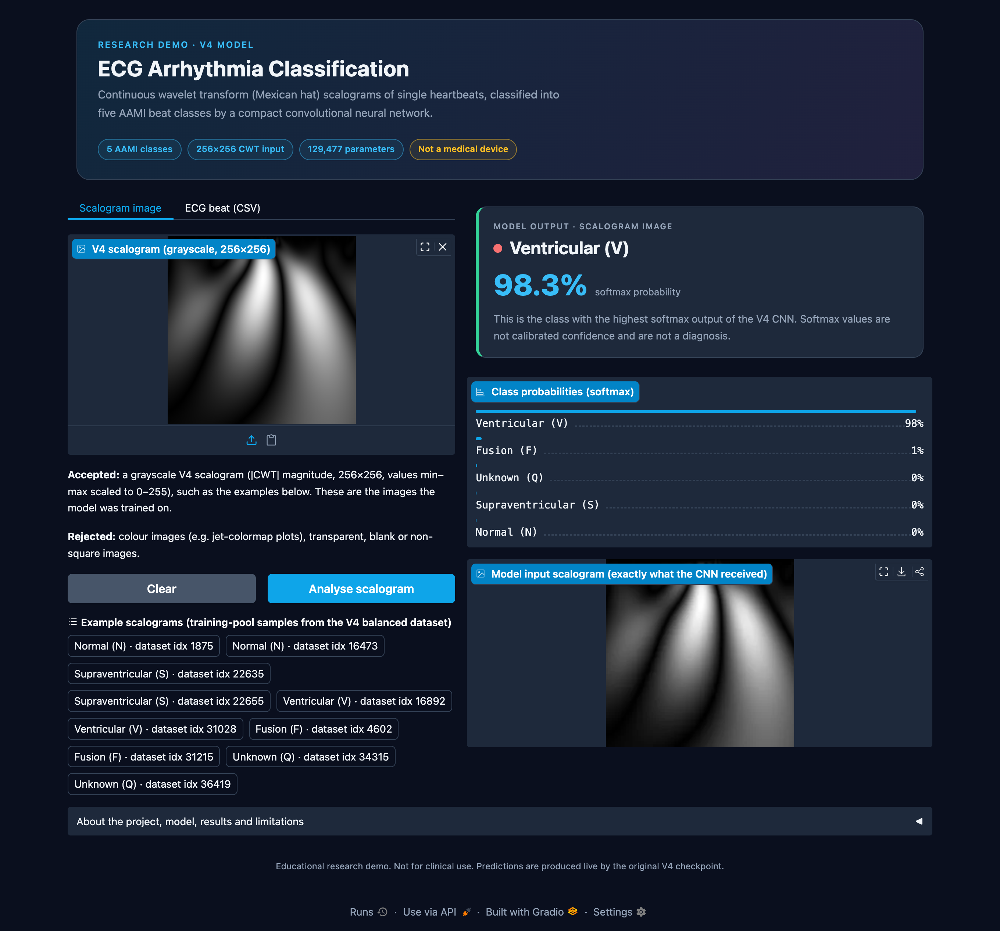
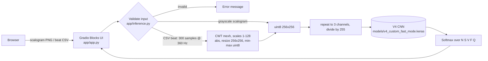
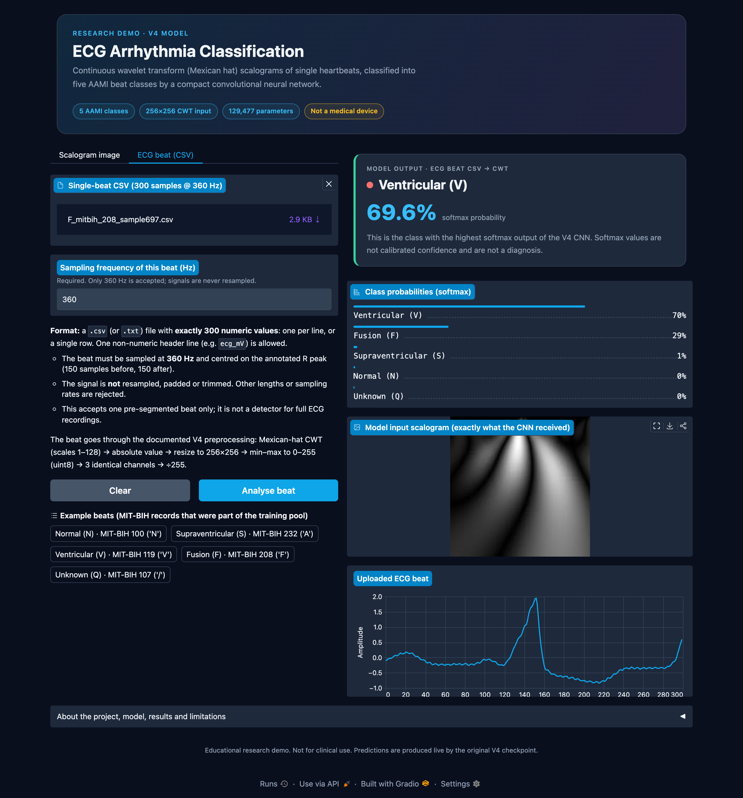
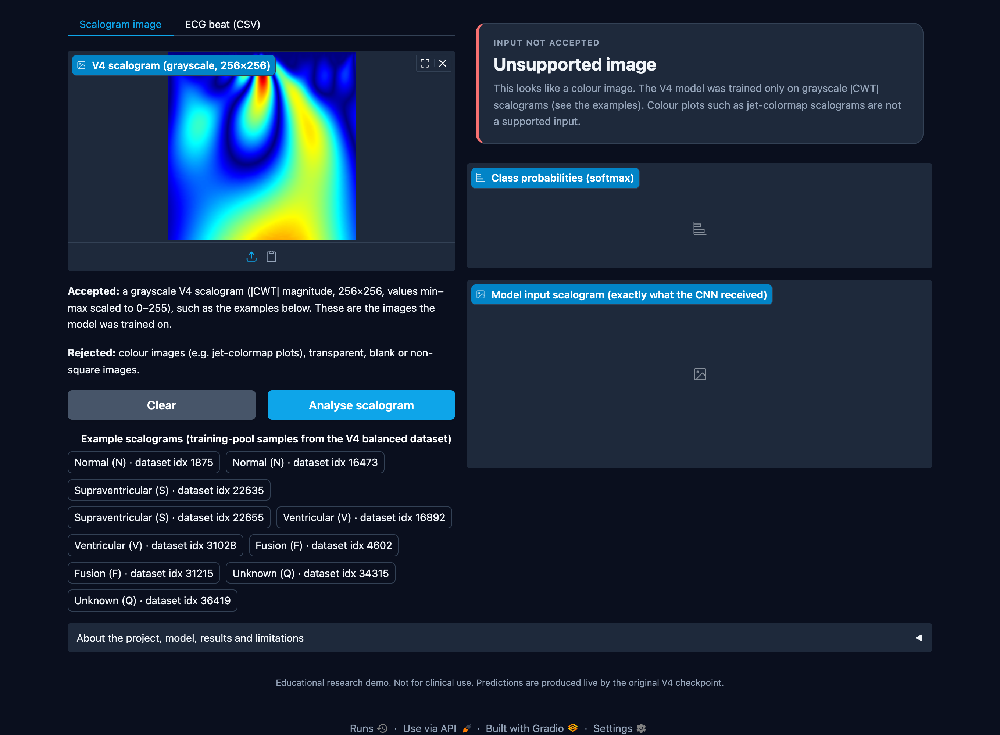
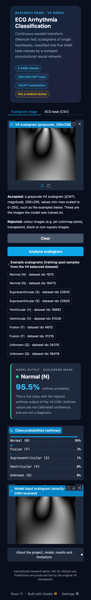

# ECG Arrhythmia Classification with CWT Scalograms and a CNN

Single-heartbeat ECG classification into the five AAMI beat classes (**N, S, V, F, Q**). Each beat is turned into a
continuous-wavelet-transform (CWT) scalogram and classified by a compact convolutional neural network. The repository
contains the trained V4 model, an interactive Gradio demo that runs it, and a curated notebook documenting how it was built.

> **Research and portfolio project, not a medical device.** The model has not been clinically validated, and its
> historical accuracy figure is not an independent estimate of performance (see [Results](#existing-experimental-results)).



## Contents
- [Problem statement](#problem-statement)
- [Features](#features)
- [Technology stack](#technology-stack)
- [System architecture](#system-architecture)
- [Screenshots](#screenshots)
- [Installation](#installation)
- [Running the application](#running-the-application)
- [Model and notebook](#model-and-notebook)
- [Datasets](#datasets)
- [Prediction workflow](#prediction-workflow)
- [Existing experimental results](#existing-experimental-results)
- [Known limitations](#known-limitations)
- [Future improvements](#future-improvements)
- [Repository structure](#repository-structure)

## Problem statement

Arrhythmia screening on long ECG recordings means classifying thousands of individual beats. The AAMI EC57
recommendation groups beat annotations into five classes: normal and bundle-branch beats (N), supraventricular ectopic (S),
ventricular ectopic (V), fusion (F) and paced/unclassifiable (Q). This project explores a time–frequency approach:
represent each beat as a Mexican-hat CWT scalogram, and treat classification as an image-recognition problem for a CNN.

## Features

- **Live inference with the trained V4 checkpoint.** All predictions come from the actual model; nothing is simulated.
- **Two input modes**
  - *Scalogram image*: a grayscale V4 scalogram (256×256).
  - *Single ECG beat (CSV)*: exactly 300 samples at 360 Hz, centred on the R peak. The app applies the original V4
    preprocessing (verified against the original data, see below) and shows the beat and its scalogram.
- **Input validation with clear errors.** Colour/jet images, transparent or blank images, wrong lengths, missing or
  non-numeric values and sampling rates other than 360 Hz are rejected. Signals are never silently resampled.
- Softmax probabilities for all five classes, plus the exact model-input scalogram.
- Example inputs (clearly marked as training-pool samples), model information, limitations and a disclaimer in the UI.
- Responsive layout (desktop and mobile), dark theme.
- Automated tests for preprocessing parity, validation, prediction and the HTTP API.

## Technology stack

| Area | Tools |
|---|---|
| Model | TensorFlow 2.20 / Keras 3.13.2 (CNN, 129,477 parameters) |
| Signal processing | PyWavelets (CWT, Mexican hat), OpenCV (resize, min–max normalisation), NumPy |
| Application | Gradio 6 (Blocks UI and HTTP API in one Python process) |
| Original data pipeline | WFDB, h5py, scikit-learn (Google Colab) |
| Testing | pytest, gradio_client, Playwright (screenshots) |

## System architecture



There is no separate frontend or backend service: Gradio serves the UI and exposes two API endpoints
(`/predict_image`, `/predict_beat`) from the same process. Inference logic is isolated in `app/inference.py`.

## Screenshots

All screenshots show real output of the running app (captured with `scripts/take_screenshots.py`).

| Scalogram input | ECG beat CSV input |
|---|---|
|  |  |

| Input validation | Mobile |
|---|---|
|  |  |

The CSV example above is a **fusion (F)** beat that the model classifies as **ventricular (V)**. F is the weakest
class in the historical results. The model's actual output on every shipped example, including the 4 of 15 it gets
wrong, is listed in [examples/README.md](examples/README.md).

## Installation

Requires **Python 3.11** (tested on 3.11.9, macOS arm64). TensorFlow 2.20 also supports other platforms, but they
were not tested here.

```bash
git clone <your-repository-url>
cd ECG_Arrhythmia_Detection_CWT_CNN
python3.11 -m venv .venv
source .venv/bin/activate        # Windows: .venv\Scripts\activate
pip install -r requirements.txt
```

The model file (`models/v4_custom_fast_mode.keras`, 1.6 MB) is included in the repository. It was saved with
Keras 3.13.2; older Keras 3 versions such as 3.3 fail to deserialise it, so keep the pinned versions.

## Running the application

```bash
python app/app.py
```

Then open <http://127.0.0.1:7860>. Use `GRADIO_SERVER_PORT=7861 python app/app.py` to pick another port.
The model loads once at startup, in about a second.

There is no separate frontend build step: the UI is defined in Python (`app/app.py`) and served by Gradio.

### Tests

```bash
pip install -r requirements-dev.txt
python -m pytest -q
```

The suite (61 tests) checks model loading, byte-identical parity with the original preprocessing code, input
validation, predictions on all examples, and the running app's HTTP API.

## Model and notebook

- **Model:** `models/v4_custom_fast_mode.keras`. Conv(32, 5×5, s2) → MaxPool → BN → Conv(64, 3×3, s2) → MaxPool → BN →
  Conv(128, 3×3) → GAP → Dense(256) → Dropout(0.5) → Dense(5, softmax). Details in [docs/MODEL_CARD.md](docs/MODEL_CARD.md).
- **Notebook:** [`notebooks/ECG_CWT_CNN_V4_Pipeline.ipynb`](notebooks/ECG_CWT_CNN_V4_Pipeline.ipynb), a curated copy of
  the original Colab notebooks. Code cells and their saved outputs are copied verbatim (provenance in each cell's
  metadata); explanatory Markdown was added. Exploratory dead ends and several cells that drew synthetic figures
  were removed and are listed in the notebook. It was not re-executed and requires the original data to run.

## Datasets

Raw recordings and generated datasets are **not** included (the balanced dataset alone is 1.1 GB). The V4 model was built from:

- **MIT-BIH Arrhythmia Database:** 48 records, 360 Hz ([PhysioNet `mitdb`](https://physionet.org/content/mitdb/1.0.0/)).
- **MIT-BIH ST Change Database:** 27 records, 301–327, 360 Hz ([PhysioNet `stdb`](https://physionet.org/content/stdb/1.0.0/)).
  The original code stored these in a folder named "INCART", but their header files are byte-identical to the official
  `stdb` headers. The St Petersburg INCART database was not used.

Generated V4 data: 185 HDF5 batch files (record-wise train/validation split), then a balanced set of **39,982**
scalograms (N 20,000 · S 3,594 · V 7,550 · F 802 · Q 8,036). Full provenance, the recovered record split and the class
mapping are in [docs/DATASETS.md](docs/DATASETS.md). Data licences and citations are in [NOTICE.md](NOTICE.md).

## Prediction workflow

1. **Beat CSV:** parse exactly 300 finite values (single column or row, optional header). Require a declared sampling
   rate of 360 Hz. Warn if the largest deflection is far from the centre.
2. **CWT:** `pywt.cwt(beat, scales=1..128, 'mexh')` → `abs` → `cv2.resize` to 256×256 → `cv2.normalize` to 0–255 → `uint8`.
3. **Scalogram image (alternative entry):** must be grayscale, opaque and square. A non-256 size is resized, with a warning.
4. **Model input:** repeat the grayscale image to 3 channels and divide by 255, giving shape (1, 256, 256, 3).
5. **Predict:** softmax over N, S, V, F, Q. The app shows the top class, all probabilities and the exact input image.

**Preprocessing verification.** `scripts/verify_preprocessing_parity.py` regenerated 13,000 beats from the raw records
and compared them with the original V4 batch files. All annotation symbols matched. Pixels matched exactly, except that
in about 20% of images the single brightest pixel differs by one grey level (254 vs 255), because of float truncation in
the original `astype('uint8')` across library versions. On 1,000 beats tested, the predicted class was identical.

## Existing experimental results

The original training notebook reports, on 7,997 beats:

| Accuracy | Macro F1 | F1 N | F1 S | F1 V | F1 F | F1 Q |
|---|---|---|---|---|---|---|
| 94.64% | 0.87 | 0.96 | 0.83 | 0.95 | 0.60 | 0.99 |

**These are historical numbers, not independently validated, and they overstate real-world performance:**
- The 7,997 beats come from the same pool used for training. Training used unseeded, beat-level random splits that
  changed between sessions, so most of these beats were probably seen during training.
- Beats from the same patient appear in both training and evaluation data. No patient-wise or external evaluation exists.
- Class Q consists mostly of paced beats (`/`), which have a very distinctive morphology. Its near-perfect score
  should not be read as general performance on unclassifiable beats.

## Known limitations

- **Not for clinical use.** No regulatory or clinical validation.
- Accepts **one pre-segmented, R-peak-centred, 360 Hz beat** (or its V4 scalogram). No R-peak detection, filtering,
  signal-quality assessment or rhythm analysis; arbitrary ECG recordings are not supported.
- The training data combines two databases recorded for different purposes (arrhythmia annotation and ST-segment
  changes, mostly during exercise tests). 98.5% of the ST Change beats in the readable batch files are annotated N.
- Example inputs come from records used in training.
- Softmax probabilities are not calibrated confidence.
- Minor numeric differences (±1 grey level on one pixel) versus the original preprocessing environment, as described above.

## Future improvements

- Retrain and evaluate with a **record-wise (inter-patient) split**. The original split has been recovered (docs/DATASETS.md).
- Evaluate on an external database not used in training (for example the St Petersburg INCART database).
- Add R-peak detection so that full recordings can be segmented automatically.
- Report calibrated probabilities and per-record metrics; test on an external dataset.

## Repository structure

```
app/            Gradio UI (app.py) and inference logic (inference.py)
models/         v4_custom_fast_mode.keras (deployed checkpoint)
notebooks/      ECG_CWT_CNN_V4_Pipeline.ipynb (curated, historical outputs)
examples/       example scalograms and single-beat CSVs (+ provenance manifest)
docs/           MODEL_CARD.md, DATASETS.md, assets/
screenshots/    real screenshots of the app
scripts/        preprocessing parity check, example export, screenshot capture
tests/          pytest suite
```

## License

Code: MIT (see [LICENSE](LICENSE)). Data derived from PhysioNet remains under its original licences (see [NOTICE.md](NOTICE.md)).
